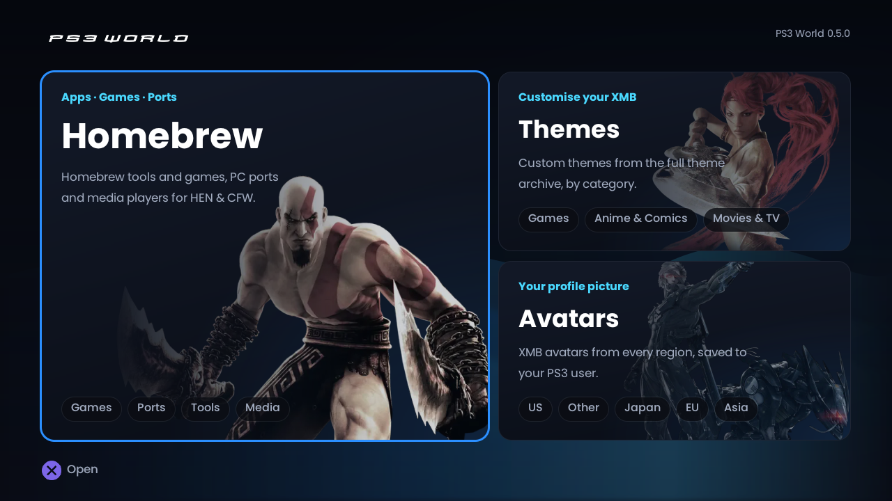
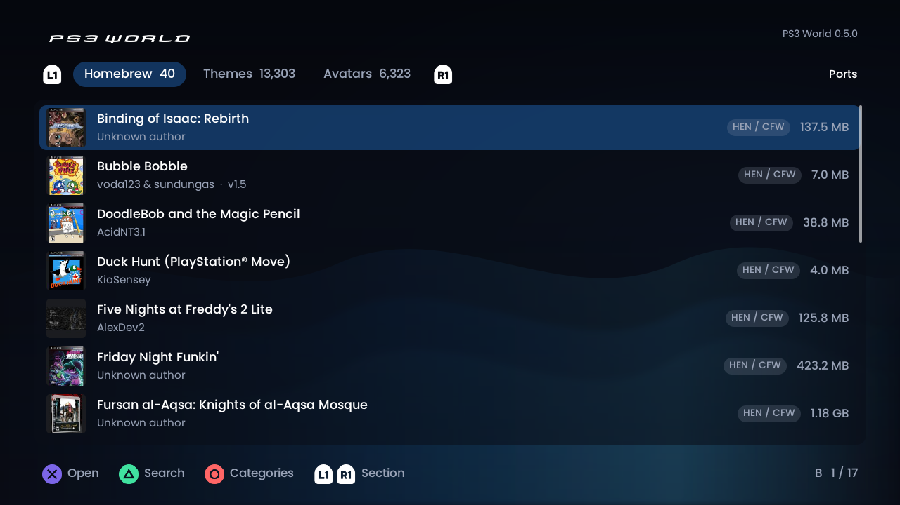
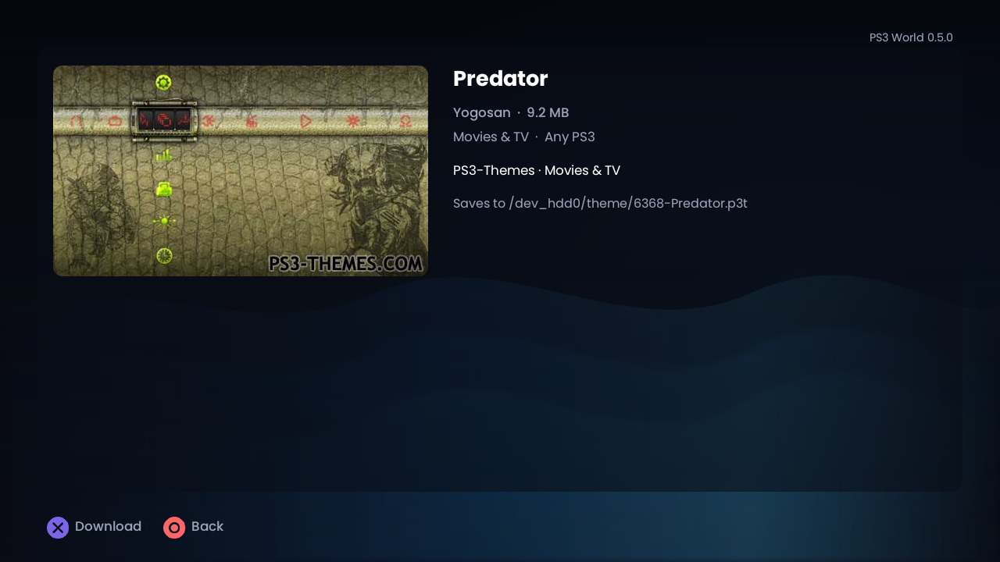
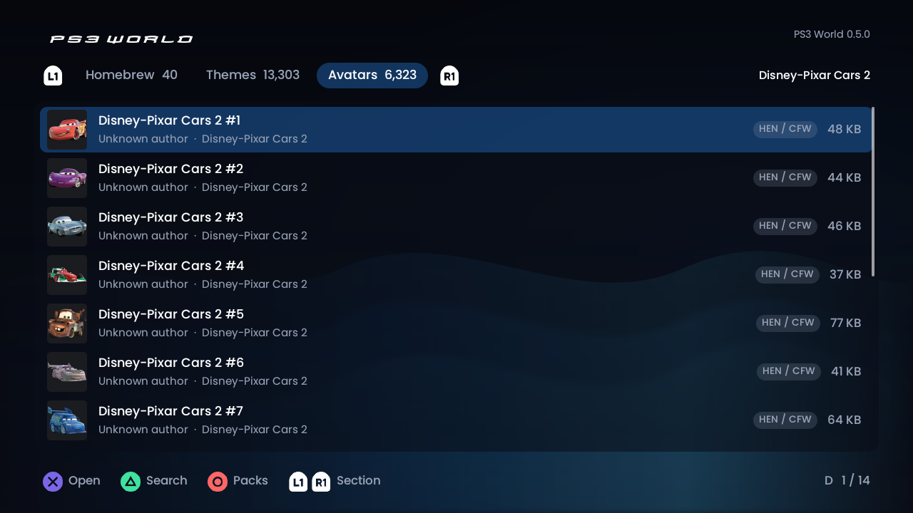

# ps3world-app

**PS3 World** for the PlayStation 3 (HEN and CFW): browse the [PS3 World](https://ps3.world) archives on the console and download homebrew, themes and avatars straight from `dl.ps3.world`, without a PC.

## Screenshots

| | |
|---|---|
|  |  |
| Home: the three sections, styled as ps3.world's home page | A list: Homebrew > Ports |
|  |  |
| A theme: its preview, and where it saves (`/dev_hdd0/theme`) | Avatars: a pack, opened as a folder |

## Features

- **Homebrew, themes and avatars** in the site's categories: Homebrew by Games, Ports, Edits (modded PS2 Classics), Tools and Media; themes by their 17 categories; avatars by region, in packs.
- **Search** any list (Triangle), and jump by letter with L2/R2. **Sort** a list A–Z, newest first or largest first (Select).
- **Surprise me** (Square on a section's categories): something at random, from 13,000 themes or all the homebrew.
- **Previews** of what you're downloading: a theme's screenshot, an avatar, a homebrew's art.
- **Saves where the PS3 looks:** PKGs to `/dev_hdd0/packages` (Package Manager > Install Package Files), themes to `/dev_hdd0/theme`, avatars to the chosen user's `psn_avatar` folder.
- **Checked downloads:** every file's size and sha256 are checked before it's kept, and a stopped download resumes where it left off.
- **A download queue:** start several and keep browsing; the one running shows bottom right. Square on an avatar pack queues every avatar in it.
- **Before a big download** (1 GB or more) it says how big and roughly how long at the speed downloads have been getting, and checks there's room on the HDD.
- **Full-screen previews** (Triangle on an item).
- **Favourites:** Select on an item stars it; they have their own card on the home screen (and a tab in My downloads).
- **Recently added:** each section lists what's new in the last 30 days, and a **New** ticker along the top of the home screen scrolls through it.
- **My downloads** (Triangle on the home screen): the queue, then everything on the HDD with its date. Delete a file (Square twice), or get a homebrew's new version.
- **Free space** on the HDD, on the home screen.
- **Updates:** when a newer PS3 World is out, the home screen says so, and Square downloads it.
- **Credits & contact** (Start on the home screen): who made it, what it's built with, and where to send your own homebrew, themes or avatars (ps3.world/contact).
- **1080p:** with the PS3 set to 1080p, everything is drawn at the full resolution (the graphics chip draws; the CPU fallback is 720p). On a 4:3 TV the picture is letterboxed at the right shape.
- **Sound effects:** soft clicks as you move and choose (off in the Language screen, under Select).
- **16 languages:** English, Spanish, Portuguese, French, German, Italian, Dutch, Polish, Turkish, Danish, Indonesian, Russian, Chinese (Simplified), Japanese, Korean and Arabic (joined letters, and the whole screen laid out right to left, controls included). It follows the PS3's language; Select on the home screen opens a grid of flags to pick another. Chinese, Japanese and Korean use the PS3's own system fonts. The words are in `data/lang/<code>.txt`, and homebrew's descriptions in `generator/descriptions/<code>.json`.

## Controls

| Button | Does |
|---|---|
| D-pad | move (Left/Right: a page at a time in lists) |
| Cross | open, download |
| Circle | back |
| Square | clear a search; download a whole avatar pack; Surprise me on a section's categories; cancel a download; delete in My downloads; get an update on the home screen |
| Triangle | search a list; the preview full screen on an item; My downloads on the home screen |
| Select | the language (and sounds) on the home screen; the sort order in a list; favourite an item |
| Start | Credits & contact, on the home screen |
| L1 / R1 | in a list, the previous / next category (Games, Ports, Edits...); on the categories screen, the previous / next section; in My downloads, My downloads / Favourites. The bar at the top shows which. |
| L2 / R2 | the previous / next letter |

Hold R1 while the app starts to try the graphics chip again after a freeze, or L1 to use the CPU renderer that once.

## Adding content and releases

The app reads a catalogue that `generator/make-catalog.mjs` builds from the sites' data and `generator/homebrew.manifest.json` ([generator/README.md](generator/README.md)). After adding to a site or the manifest, rebuild it and upload it; consoles pick it up the next time the app starts.

To release a new version: put its PKG in `D:PS3 WORLD R2homebrewtools` as `PS3WorldApp-v<version>.pkg`, upload it (the deployer's Downloads card), run `G:DeployerRebuild app catalogue.cmd`, then upload the catalogue (its ps3world-catalog card). Apps from 0.6.0 on offer it on the home screen. Tag the commit `v<version>` for the GitHub release.

## Layout

| Path | What |
|---|---|
| `src/` | the app (C, PSL1GHT); `src/ps3/` is the console backend |
| `src/catalog.c` | catalog.json, parsed and checked |
| `src/lang.c`, `src/i18n.c`, `data/lang/`, `data/flags/` | the languages: tr(), the PS3's language or the one picked, each language's words, and its flag (`tools/make-flags.mjs` makes them from flag-icons) |
| `generator/` | Node script that builds catalog.json and the icons from the site build |
| `tools/https_test.c` | the app's HTTPS client run on Linux against dl.ps3.world (CI) |
| `tools/make-art.mjs` | ICON0, PIC1 and the in-app background, from the site |
| `.github/workflows/ps3.yml` | CI: HTTPS test, PS3 toolchain (cached), EBOOT + PKG |

## Building

Push to GitHub and Actions builds `PS3World.pkg` (artifact **PS3World**). The toolchain (ps3toolchain + PSL1GHT, pinned) is built once and cached; Mbed TLS 3.6.7 is built per run by `tools/build-mbedtls.sh`.

Title ID `PSWD00001`; it installs to `/dev_hdd0/game/PSWD00001/`. The log is `USRDIR/ps3world_log.txt`, and `USRDIR/downloaded.txt` lists what's been downloaded. `docs/TEST-CHECKLIST.md` is the on-console test.

## Licence

GPL-2.0. Based on [Resonant for Plex](https://github.com/daedra000/Resonant-PS3) (HTTPS client, drawing, fonts, input, worker threads, build). Third-party licences are in `data/licenses/`.
